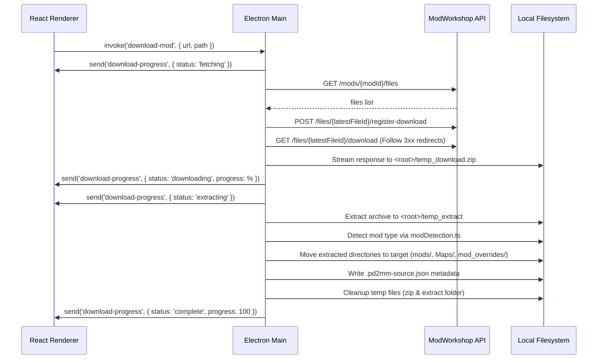

# PD2MM (Payday 2 Mod Manager)

PD2MM is a desktop mod manager for **PAYDAY 2** built with Electron, Vite, TypeScript, and React. It supports common mod packaging formats, non-destructive mod toggling, custom mod collections, direct downloads from ModWorkshop (including `mws-pdmm://` deep-linking), and built-in release updates.

---

## Table of Contents

- [Features](#features)
- [Download & Getting Started](#download--getting-started)
- [System Architecture & Monorepo Structure](#system-architecture--monorepo-structure)
- [PAYDAY 2 Mod File Model](#payday-2-mod-file-model)
- [Core Subsystems & Implementation Details](#core-subsystems--implementation-details)
  - [1. Mod Detection Engine](#1-mod-detection-engine)
  - [2. Download, API & Archive Extraction](#2-download-api--archive-extraction)
  - [3. Deep-Link Protocol Handler](#3-deep-link-protocol-handler)
  - [4. Mod Metadata & Update Checking](#4-mod-metadata--update-checking)
  - [5. Collections Engine](#5-collections-engine)
  - [6. Game Launcher](#6-game-launcher)
  - [7. Application Auto-Updater](#7-application-auto-updater)
- [Complete IPC Communication Contract](#complete-ipc-communication-contract)
- [Frontend Architecture & UI Components](#frontend-architecture--ui-components)
- [Build System & Dev Pipeline](#build-system--dev-pipeline)
- [Step-by-Step Recreation Blueprint](#step-by-step-recreation-blueprint)
- [Edge Cases & Gotchas](#edge-cases--gotchas)
- [Troubleshooting](#troubleshooting)
- [License & Credits](#license--credits)

---

## Features

- **Direct Mod Installation**: Download and install mods directly from ModWorkshop URLs.
- **Deep-Link Integration**: Handle browser clicks using the `mws-pdmm://install/<modId>` protocol.
- **Full Mod Support**: Automatic routing for BLT/BeardLib mods, custom Maps/Heists, and Mod Overrides.
- **Non-Destructive Toggling**: Enable or disable mods instantly without deleting files.
- **Mod Collections**: Snapshot active mods into named presets (e.g. "Stealth", "Loud") and apply them with one click.
- **Mod Updates**: Query the ModWorkshop API to check and update mods in-place.
- **Integrated Game Launcher**: Launch PAYDAY 2 via Steam protocol with executable fallback.
- **Theming**: Dark, White (Light), and System color schemes with frameless window controls.
- **Release Auto-Updater**: Built-in release updates using `electron-updater`.

---

## Download & Getting Started

### Download
Download packaged installers for Windows (`.exe`) and Linux (`.flatpak`) from [GitHub Releases](https://github.com/CloodDev/PD2MM/releases).

### Getting Started
1. Launch PD2MM.
2. Click **📁 Select Game Folder** in the header and choose your PAYDAY 2 installation folder.
3. Paste a ModWorkshop link (e.g. `https://modworkshop.net/mod/12345`) and click **⬇️ Download**, or click a supported `mws-pdmm://` link in your browser.
4. Select installed mods in the sidebar to view details, toggle on/off, open the mod folder, check for updates, or uninstall.

---

## System Architecture & Monorepo Structure

PD2MM uses **npm workspaces** with a modular multi-process architecture:

```
pd2mm/
├── package.json                 # Root monorepo configuration & workspaces
├── electron-builder.mjs         # Electron Builder packaging configuration
├── vitest.config.ts             # Vitest configuration for unit tests
├── buildResources/              # App icons (.icns, .png, multi-res sizes)
├── scripts/
│   ├── compile.mjs              # Multi-platform build & package script
│   ├── bump-version.mjs         # Semantic version bumper
│   ├── generate-changelog.mjs   # Git log changelog generator
│   └── publish.mjs              # Release publisher script
├── tests/
│   ├── setupTests.ts            # Testing library environment setup
│   └── e2e.spec.ts              # Playwright desktop launch & window tests
└── packages/
    ├── dev-mode.js              # Multi-package Vite development orchestrator
    ├── entry-point.js           # Electron main process entry point
    ├── electron-versions/       # Helper querying Chrome/Node versions
    │   ├── index.js
    │   └── package.json
    ├── integrate-renderer/      # Bootstrap script adapting Vite React templates
    │   ├── index.js
    │   └── package.json
    ├── preload/                 # Electron Preload script
    │   ├── package.json
    │   ├── vite.config.js       # Vite lib build with virtual browser exports
    │   └── src/
    │       ├── index.ts         # Secure IPC proxy exposed to window.electron
    │       ├── exposed.ts       # ContextBridge injection script
    │       ├── nodeCrypto.ts    # Node crypto wrapper (sha256sum)
    │       └── versions.ts      # Exposes process.versions
    ├── main/                    # Electron Main Process (Node / ESM)
    │   ├── package.json
    │   ├── vite.config.js       # Vite lib build with Electron auto-restart
    │   └── src/
    │       ├── index.ts         # Main IPC handlers, mod lifecycle, collections
    │       ├── modInstaller.ts  # ModWorkshop API fetcher, download & extraction
    │       ├── modDetection.ts  # Mod structure heuristics (BLT vs Override vs Map)
    │       ├── AppModule.ts     # Lifecycle interface for main process plugins
    │       ├── ModuleContext.ts # Context object passed to plugins
    │       ├── ModuleRunner.ts  # Sequential modular plugin loader
    │       ├── AppInitConfig.ts # Preload & renderer path configurations
    │       ├── modules/
    │       │   ├── WindowManager.ts              # Frameless BrowserWindow lifecycle
    │       │   ├── DeepLinkHandler.ts            # mws-pdmm:// protocol registration
    │       │   ├── SingleInstanceApp.ts          # Single instance lock guard
    │       │   ├── AutoUpdater.ts                # electron-updater wrapper
    │       │   ├── BlockNotAllowdOrigins.ts      # Web security & navigation filter
    │       │   ├── ExternalUrls.ts               # Open external URLs in default browser
    │       │   ├── HardwareAccelerationModule.ts # GPU acceleration toggles
    │       │   └── ApplicationTerminatorOnLastWindowClose.ts
    │       └── __tests__/
    │           └── modDetection.spec.ts
    └── renderer/                # React Single Page Application (UI)
        ├── package.json
        ├── vite.config.js       # React Vite config with base ./
        ├── index.html           # HTML root with #root element
        ├── public/              # Icons and static web assets
        └── src/
            ├── main.jsx         # React root mounting App.jsx
            ├── App.jsx          # Central state, event coordination, layout
            ├── TitleBar.jsx     # Draggable frameless custom window title bar
            ├── TitleBar.css
            ├── index.css        # Global CSS resets and body styling
            ├── components/
            │   ├── ModList.jsx           # Searchable mod list with context menu
            │   ├── CollectionManager.jsx # Mod collections drawer & creator
            │   ├── ModInfo.jsx           # Mod detail panel & action controls
            │   ├── ModDownloader.jsx     # URL download input form
            │   ├── WorkspaceHero.jsx     # Stats header banner (Path & Counts)
            │   └── NotificationStack.jsx # Toast notifications with actions
            └── styles/
                ├── variables.css         # Dark & Light CSS custom properties
                ├── layout.css            # Flexbox container grid and panels
                ├── components.css        # Buttons, inputs, chips, badges
                ├── mods.css              # Mod sidebar list items & state tags
                ├── collections.css       # Collections panel styling
                ├── context-menu.css      # Floating right-click context menu
                ├── downloader.css        # Download URL bar styling
                ├── notifications.css     # Notification cards & progress bars
                └── workspace.css         # Header summary hero styling
```

---

## PAYDAY 2 Mod File Model

PAYDAY 2 organizes mods across three primary locations inside the game directory:

| Mod Category | Active Folder | Disabled Folder | Identification Heuristic |
| :--- | :--- | :--- | :--- |
| **BLT / BeardLib Mods** | `<root>/mods/<name>` | `<root>/mods/.pd2mm_disabled/<name>` | Contains `mod.txt` or `supermod.xml` |
| **Maps / Heists** | `<root>/Maps/<name>` | `<root>/Maps/.pd2mm_disabled/<name>` | Contains `main.xml` with `<level` tag |
| **Mod Overrides** | `<root>/assets/mod_overrides/<name>` | `<root>/assets/mod_overrides/.pd2mm_disabled/<name>` | Contains known engine folders (`units`, `soundbanks`, etc.), `main.xml` with `<Weapon`, or `add.xml` |

### Non-Destructive Mod Toggle (`.pd2mm_disabled`)
Instead of deleting files, disabling a mod moves its directory into a hidden `.pd2mm_disabled` subfolder within its category folder. Enabling moves it back to the active directory.

### Utility Folder Protection
Engine-critical folders inside `<root>/mods` are ignored by mod scanning:
`saves`, `logs`, `downloads`, `base`, and `.pd2mm_disabled`.

### Mod Source Tracking
Installed mods record their origin in `<modFolder>/.pd2mm-source.json`:
```json
{
  "provider": "modworkshop",
  "modId": "12345",
  "sourceUrl": "https://modworkshop.net/mod/12345",
  "savedAt": "2026-10-12T15:00:00.000Z",
  "latestFileId": 67890,
  "latestVersion": "1.4.2"
}
```

---

## Core Subsystems & Implementation Details

### 1. Mod Detection Engine (`modDetection.ts`)
Inspects extracted archive folders and returns the target folder and whether to move folder contents directly:
1. If folder name is `assets/mod_overrides` $\rightarrow$ `{ kind: "override-folder", destination: "assets/mod_overrides", moveContents: true }`.
2. If `supermod.xml` or `mod.txt` exists $\rightarrow$ `{ kind: "blt", destination: "mods" }`.
3. If `main.xml` exists:
   * Contains `<level` $\rightarrow$ `{ kind: "map", destination: "maps" }`.
   * Contains `<Weapon` $\rightarrow$ `{ kind: "weapon", destination: "assets/mod_overrides", moveContents: false }`.
4. If `add.xml` exists $\rightarrow$ `{ kind: "weapon", destination: "assets/mod_overrides", moveContents: false }`.
5. If any known engine folder exists (`anims`, `core`, `effects`, `environments`, `fonts`, `gamedata`, `guis`, `lib`, `movies`, `physic_effects`, `settings`, `shaders`, `soundbanks`, `strings`, `units`) $\rightarrow$ `{ kind: "override-folder", destination: "assets/mod_overrides", moveContents: true }`.
6. Default fallback $\rightarrow$ `{ kind: "override", destination: "assets/mod_overrides", moveContents: false }`.

---

### 2. Download, API & Archive Extraction (`modInstaller.ts`)



#### Extraction Strategy by OS
- **Windows**:
  1. For `.zip`: Spawns PowerShell `Expand-Archive -Force -Path ... -DestinationPath ...`.
  2. For `.7z` / `.rar`: Checks for 7-Zip (`C:\Program Files\7-Zip\7z.exe` or `x86`) or WinRAR (`UnRAR.exe`), falling back to CLI tools.
  3. Falls back to PowerShell `Expand-Archive`.
- **Linux**:
  - Attempts CLI extractors in sequence: `unzip`, `bsdtar`, `7z` / `7za` / `7zr`, `unar`, `unrar`.
  - For `.zip`, falls back to Node's `adm-zip` if CLI tools are missing.

---

### 3. Deep-Link Protocol Handler (`DeepLinkHandler.ts`)
Registers and handles the custom URI scheme: `mws-pdmm://install/<modId>`:
1. **Registration**: Calls `app.setAsDefaultProtocolClient('mws-pdmm')`.
2. **Cold Start**: On app startup, checks `process.argv` for `mws-pdmm://`. If found, stores the link, waits for `BrowserWindow` loading to finish (`isLoading() === false`), and sends the event to the renderer.
3. **Warm Start**: When a link is clicked while PD2MM is running, `app.on('second-instance')` catches the arguments, brings the window to focus, and dispatches the `'deep-link'` event.
4. **Renderer Processing**: React sets the download link and immediately initiates the download workflow.

---

### 4. Mod Metadata & Update Checking
1. **Tolerant `mod.txt` Parser**:
   - Parses with `JSON.parse` first.
   - If parsing fails, strips C-style block comments (`/* */`) and line comments (`//`), then extracts values (`name`, `version`, `author`, `image`, `color`) via regex fallback.
2. **Accent Color Support**:
   - Reads `color`, `backgroundColor`, or `bgcolor` fields from `mod.txt`.
   - Normalizes normalized 0–1 float vectors, 0–255 integer vectors, and hex strings into standard `#RRGGBB` format for custom sidebar highlights.
3. **BeardLib `main.xml` Support**:
   - Matches `<name>`, `<author>`, and `<version>` XML tags when `mod.txt` is absent.
4. **Version Comparison (`compareVersionStrings`)**:
   - Compares numeric segments (`1.10.0` > `1.9.0`) chunk by chunk.
   - Falls back to semantic version string comparisons.

---

### 5. Collections Engine
Allows saving and switching mod loadouts:
- **Storage**: Saved to `%APPDATA%/PD2MM/collections.json`.
- **Schema**:
  ```ts
  type ModCollection = {
    id: string;          // e.g. "collection_1712900000000"
    name: string;        // e.g. "Stealth Only"
    createdAt: string;   // ISO timestamp
    mods: Array<{
      name: string;
      type: "mod" | "map" | "override";
      enabled: boolean;
    }>;
  };
  ```
- **Apply Workflow**: Scans all active and disabled mods. Moves mods marked enabled in the collection to active directories; moves all other mods to `.pd2mm_disabled`.
- **Deselect Workflow**: Restores all mods to active state.

---

### 6. Game Launcher (`launch-game`)
1. First attempts to open the Steam URL: `steam://rungameid/218620`.
2. If Steam fails or is unavailable, scans the game directory for executable binaries:
   - **Windows**: `payday2_win32_release.exe`
   - **Linux**: `payday2_release`, `payday2.x86_64`, `payday2_linux`
3. Launches the binary detached using `child_process.spawn`.

---

### 7. Application Auto-Updater (`AutoUpdater.ts`)
- Powered by `electron-updater` configured for GitHub Releases (`CloodDev/PD2MM`).
- Disabled during development mode (`!app.isPackaged`).
- Provides manual update checks from the header button.
- Streams live progress (`checking`, `available`, `downloading`, `downloaded`, `not-available`, `error`) to the renderer via `update:status`.

---

## Complete IPC Communication Contract

Preload securely bridges Electron IPC to `window.electron.ipcRenderer`:

| Channel | Invocation | Arguments | Return / Payload | Description |
| :--- | :--- | :--- | :--- | :--- |
| `select-directory` | `invoke` | `operation: "open" \| "export"` | `string \| null` | Native directory selector dialog |
| `load-settings` | `invoke` | None | `string \| false` | Reads saved game path from `settings.txt` |
| `sync-settings` | `invoke` | `path: string` | `void` | Writes game path to `settings.txt` |
| `list-mods` | `invoke` | `basePath: string` | `ModEntry[]` | Lists all active and disabled mods |
| `get-mod-data` | `invoke` | `{ basePath, name, type, enabled }` | `ModDetails` | Parses `mod.txt` / `main.xml` and reads icon |
| `toggle-mod-enabled`| `invoke` | `{ basePath, name, type, enabled }` | `{ success: boolean, error?: string }` | Moves mod between active and `.pd2mm_disabled` |
| `remove-mod` | `invoke` | `{ basePath, name, type, enabled }` | `{ success: boolean, error?: string }` | Deletes mod directory recursively |
| `open-mod-folder` | `invoke` | `{ basePath, name, type, enabled }` | `void` | Opens folder in native file manager |
| `download-mod` | `invoke` | `{ url: string, path: string }` | `boolean` | Downloads & installs mod from ModWorkshop |
| `check-mod-update` | `invoke` | `{ basePath, name, type, enabled }` | `ModUpdateResult` | Checks ModWorkshop API for newer version |
| `launch-game` | `invoke` | `{ basePath: string }` | `{ success: boolean, method?: string }` | Launches game via Steam or executable |
| `load-collections` | `invoke` | None | `ModCollection[]` | Reads saved mod collections |
| `save-collection` | `invoke` | `collection: ModCollection` | `{ success: boolean }` | Saves or updates a mod collection |
| `delete-collection`| `invoke` | `collectionId: string` | `{ success: boolean }` | Deletes collection by ID |
| `apply-collection` | `invoke` | `{ basePath, collection }` | `{ success: boolean }` | Sets active mods to match collection |
| `deselect-collection`| `invoke`| `{ basePath }` | `{ success: boolean }` | Enables all available mods |
| `confirm-delete-collection` | `invoke` | `{ name: string }` | `{ confirmed: boolean }` | Shows native confirmation dialog |
| `window-minimize` | `invoke` | None | `void` | Minimizes frameless window |
| `window-maximize` | `invoke` | None | `boolean` (isMaximized) | Toggles window maximization |
| `window-close` | `invoke` | None | `void` | Closes app window |
| `update:check` | `invoke` | None | `UpdateResult` | Manual check for app updates |
| `update:download` | `invoke` | None | `UpdateResult` | Downloads release update |
| `update:install` | `invoke` | None | `UpdateResult` | Quits and applies update |
| `download-progress`| `on` | Event payload | `{ status, progress, error? }` | Live mod download progress |
| `update:status` | `on` | Event payload | `{ status, version?, progress?, error? }` | Live app updater progress |
| `deep-link` | `on` | Event payload | `{ url, host, pathname, ... }` | URL received from browser click |

---

## Frontend Architecture & UI Components

The UI is built with React 19, Vite, and CSS custom properties:

- `TitleBar.jsx`: Frameless top bar with `-webkit-app-region: drag`, theme switcher (`dark` / `white` / `system`), minimize, maximize/restore, and close buttons.
- `WorkspaceHero.jsx`: Displays selected game folder path, total mod count, and currently enabled count.
- `NotificationStack.jsx`: Floating toast notification cards with tone styling (`info`, `success`, `danger`), animated progress bars, and action buttons.
- `ModList.jsx`:
  - Searchable list categorized by BLT/BeardLib Mods, Map Mods, and Mod Overrides.
  - Right-click context menu to select/deselect mods for collections or add directly to existing collections.
- `CollectionManager.jsx`:
  - Drawer panel for saving, applying, deselecting, and deleting collections.
  - "Pending mods" banner for quickly naming and saving staged mods into a new preset.
- `ModInfo.jsx`:
  - Displays mod details (image, name, author, version, type badge, enabled state).
  - Actions: Enable/Disable, Open Folder, Check for Updates, Remove.
- `ModDownloader.jsx`:
  - Input field for pasting ModWorkshop URLs with download button.

---

## Build System & Dev Pipeline

### Development Orchestration (`packages/dev-mode.js`)
1. Spawns a Vite dev server for `packages/renderer`.
2. Injects a provider plugin (`@vite-electron-builder/renderer-watch-server-provider`) exposing the dev server URL.
3. Builds `packages/preload` and `packages/main` in watch mode.
4. Re-spawns Electron automatically when `packages/main` files change; sends a full reload to the renderer when `packages/preload` changes.

### Electron Builder Configuration (`electron-builder.mjs`)
- Dynamically includes files from each workspace's `dist/**` directory using `@npmcli/map-workspaces`.
- Registers the `mws-pdmm` protocol scheme.
- Configures NSIS (Windows x64 / ia32) and Flatpak (Linux) targets.

---

## Step-by-Step Recreation Blueprint

Follow these steps to recreate the project from scratch:

### 1. Initialize Root Project
Create root `package.json`:
```json
{
  "name": "pd2mm",
  "description": "Payday 2 Mod Manager built with Electron, Vite, and TypeScript.",
  "version": "1.0.0",
  "private": false,
  "type": "module",
  "main": "packages/entry-point.js",
  "workspaces": [
    "packages/*"
  ],
  "engines": {
    "node": ">=23.0.0"
  },
  "scripts": {
    "build": "npm run build --workspaces --if-present",
    "start": "node packages/dev-mode.js",
    "compile": "node scripts/compile.mjs",
    "compile:win": "npm run build && electron-builder build --win --config electron-builder.mjs",
    "compile:linux": "npm run build && electron-builder build --linux --config electron-builder.mjs",
    "test": "npx playwright test ./tests/e2e.spec.ts",
    "test:unit": "vitest",
    "typecheck": "npm run typecheck --workspaces --if-present"
  },
  "devDependencies": {
    "@npmcli/map-workspaces": "6.0.0",
    "@playwright/test": "^1.61.0",
    "electron": "^42.4.1",
    "electron-builder": "^26.15.3",
    "vitest": "^4.1.9"
  }
}
```

### 2. Create `packages/electron-versions`
Create `packages/electron-versions/package.json` and `index.js`. Run `npx electron -p "JSON.stringify(process.versions)"` with `ELECTRON_RUN_AS_NODE: 1` to export Chrome and Node major versions.

### 3. Create `packages/preload`
1. `package.json` with ESM exports for `dist/_virtual_browser.mjs` and `dist/exposed.mjs`.
2. `src/index.ts`: Expose `ipcRenderer` methods (`invoke`, `on`, `removeListener`) under `window.electron`.
3. `src/exposed.ts`: Expose exports dynamically via `btoa(exportKey)`.
4. `vite.config.js`: Target `chrome120` with `mockExposed()` and `handleHotReload()` plugins.

### 4. Create `packages/renderer`
1. Initialize a React template using `@vitejs/plugin-react` with `base: './'`.
2. Build components: `TitleBar.jsx`, `WorkspaceHero.jsx`, `ModDownloader.jsx`, `ModList.jsx`, `CollectionManager.jsx`, `ModInfo.jsx`, `NotificationStack.jsx`.
3. Set up CSS variables in `styles/variables.css` for dark and light themes.

### 5. Create `packages/main`
1. `package.json` with dependencies on `adm-zip`, `undici`, `electron-updater`.
2. Implement plugins: `WindowManager.ts`, `DeepLinkHandler.ts`, `SingleInstanceApp.ts`, `AutoUpdater.ts`.
3. Implement `modDetection.ts`: Classification rules for BLT, maps, and overrides.
4. Implement `modInstaller.ts`: Download stream, redirect handler, archive extraction, and `.pd2mm-source.json` generator.
5. Implement `index.ts`: All IPC handlers for mod scanning, toggling, collections, settings, and launcher.

### 6. Create Entry Point & Dev Orchestration
1. `packages/entry-point.js`: Calls `initApp(...)` passing preload and renderer paths.
2. `packages/dev-mode.js`: Coordinates renderer dev server and watch builds for preload and main.
3. `electron-builder.mjs`: Sets up packaging, schemes, and build targets.

### 7. Run and Verify
```bash
# Install dependencies
npm install

# Start in development mode
npm start

# Run unit tests
npm run test:unit

# Package executable for current OS
npm run compile
```

---

## Edge Cases & Gotchas

1. **Archive Extraction Support**:
   ModWorkshop files are distributed as `.zip`, `.rar`, or `.7z`. Node's `adm-zip` only supports `.zip`. PD2MM falls back to CLI extractors (`7z`, `WinRAR`, `PowerShell`, `unzip`, `bsdtar`) to extract `.7z` and `.rar` files.
2. **Commented / Invalid `mod.txt`**:
   Many community mods contain unquoted JSON keys, trailing commas, or comments. A tolerant regex parser is necessary when `JSON.parse` fails.
3. **Steam Protocol vs Executable**:
   Launching via `steam://rungameid/218620` is preferred to maintain Steam overlay support, with fallback to direct executable spawning when offline or Steam is not running.
4. **Deep-Link Race Condition**:
   When launching via browser URL click, the deep-link argument arrives before the window finishes loading. The main process queues the URL until `mainWindow.webContents.isLoading()` is `false`.

---

## Troubleshooting

- **App update check is skipped**: Update checks run only in packaged builds, not development mode.
- **Archive extraction fails**: On Linux, install `7z`, `unar`, or `bsdtar`. On Windows, install 7-Zip or WinRAR for non-zip archive support.
- **No mods appear after selecting folder**: Ensure the selected path is the PAYDAY 2 root directory (containing `payday2_win32_release.exe` or `mods/`).

---

## License & Credits

- **License**: MIT License (see [LICENSE](./LICENSE))
- **Author**: cloodowy ([CloodDev](https://github.com/CloodDev))
- **Repository**: [https://github.com/CloodDev/PD2MM](https://github.com/CloodDev/PD2MM)